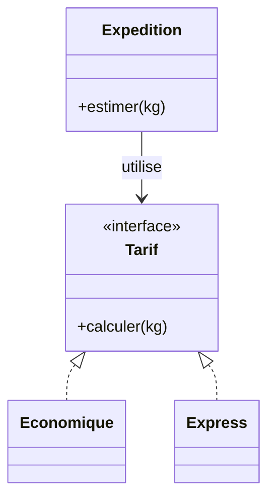

# Strategy — substituer un algorithme sans changer son client

## Problème et intention

Une application calcule le prix d'expédition selon le niveau de service : économique ou express. Les deux calculs reçoivent les mêmes données mais appliquent des règles différentes. Placer toutes les variantes dans le service principal crée une suite de branches qui grandit à chaque politique commerciale. **Strategy** isole une famille d'algorithmes derrière un contrat commun. Le client peut remplacer le calculateur sans modifier la partie qui orchestre la commande.

## Rôles et mécanisme

Le **contexte** dépend de l'interface `Tarif` ; les **stratégies concrètes** produisent chacune un coût. Le choix de la stratégie appartient à l'appelant, ici au moment de construire `Expedition`. Le contexte n'a pas besoin de connaître les noms des variantes ; il transmet le poids et utilise le résultat. Les unités sont explicites : kilogrammes en entrée, euros en sortie. Un code de production utiliserait un type monétaire adapté et définirait arrondis, poids négatifs et version des tarifs.



```ts
interface Tarif { calculer(kg: number): number }
class Economique implements Tarif {
  calculer(kg: number): number { return 4 + 1.5 * kg; }
}
class Express implements Tarif {
  calculer(kg: number): number { return 10 + 3 * kg; }
}
class Expedition {
  constructor(private tarif: Tarif) {}
  changerTarif(tarif: Tarif): void { this.tarif = tarif; }
  estimer(kg: number): number {
    if (kg < 0) throw new RangeError("Poids négatif");
    return this.tarif.calculer(kg);
  }
}
const commande = new Expedition(new Economique());
const standard = commande.estimer(2);
commande.changerTarif(new Express());
const urgent = commande.estimer(2);
```

Changer de stratégie n'est pas une transition de cycle de vie : `standard` et `urgent` sont deux estimations alternatives, non deux états successifs obligatoires. Le contexte doit cependant garantir les préconditions partagées ; si chaque stratégie valide différemment la même entrée, le contrat devient ambigu. Des tests communs aux implémentations vérifient les invariants, des tests spécifiques vérifient leurs formules.

## Coût et alternatives

Chaque classe supplémentaire accroît la surface de navigation et l'injection d'objets ne supprime pas la question « qui choisit ? ». Pour deux formules sans état, une simple fonction `(kg: number) => number` passée en paramètre peut suffire : TypeScript permet de substituer une fonction sans hiérarchie. N'utilisez pas Strategy pour maquiller une seule formule stable. Le pattern devient utile si les variantes ont leur propre configuration, des dépendances ou des tests autonomes, et si leur remplacement est un point d'extension assumé.

À comparer avec [[Pattern - State|State]] : même délégation, intention différente. State fait varier la conduite selon l'état interne et les transitions d'un objet ; Strategy laisse sélectionner un algorithme équivalent pour un même travail. À comparer aussi avec [[Pattern - Template Method|Template Method]] : Strategy compose un calculateur remplaçable ; Template Method fixe la séquence dans une classe mère et varie des étapes par héritage.

## Questions

1. Qui doit choisir la stratégie si le niveau de service vient d'une requête utilisateur non fiable ?
2. Quand une fonction injectée devient-elle moins claire qu'une interface de stratégie nommée ?

*Référence conceptuelle : Gamma, Helm, Johnson et Vlissides, **Design Patterns: Elements of Reusable Object-Oriented Software**, Addison-Wesley/Pearson, chapitre des patterns comportementaux. Exemple et formulation originaux.*
