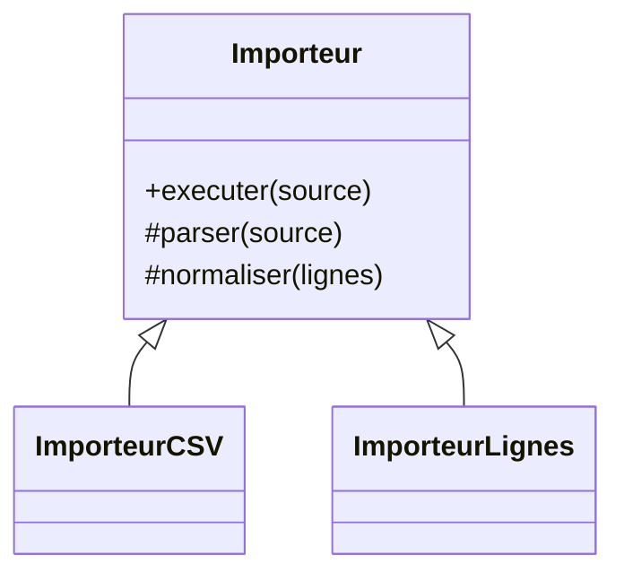

# Template Method — fixer une séquence, spécialiser ses étapes

## Problème et intention

Plusieurs importeurs lisent une entrée, la convertissent puis contrôlent le résultat avant de le rendre disponible. Le format change, mais l'ordre des étapes et la règle « ne jamais accepter une liste vide » restent identiques. Copier toute la procédure dans chaque importeur expose à des oublis ; laisser chaque classe libre d'orchestrer ses appels rend la garantie difficile à vérifier. **Template Method** place l'algorithme global dans une classe mère et délègue certaines étapes à des sous-classes.

## Rôles et mécanisme

La **méthode template** `executer` définit l'ordre et n'est pas redéfinie par les variantes dans l'exemple. `parser` est une étape abstraite, obligatoire ; `normaliser` est un **hook**, une extension facultative avec comportement par défaut. Les classes filles ne décident donc ni de l'ordre ni de la validation commune. Ici l'entrée est déjà une chaîne en mémoire : l'exemple ne prétend ni lire un fichier ni gérer des encodages réels.



```ts
abstract class Importeur {
  executer(source: string): string[] {
    const lignes = this.normaliser(this.parser(source));
    if (lignes.length === 0) throw new Error("Entrée vide");
    return lignes;
  }
  protected abstract parser(source: string): string[];
  protected normaliser(lignes: string[]): string[] { return lignes; }
}
class ImporteurCSV extends Importeur {
  protected parser(source: string): string[] { return source.split(","); }
  protected normaliser(lignes: string[]): string[] {
    return lignes.map(ligne => ligne.trim());
  }
}
class ImporteurLignes extends Importeur {
  protected parser(source: string): string[] { return source.split("\n"); }
}
const resultat = new ImporteurCSV().executer("a, b");
```

L'ordre `parser` puis `normaliser` puis contrôle est observable. Attention : la vérification de longueur n'exclut pas les chaînes vides ; c'est un invariant délibérément plus faible qu'une validation complète. Les hooks doivent avoir une sémantique et un moment d'appel documentés : un override silencieux peut violer les attentes de la classe mère. Des tests du template et des variantes sont nécessaires, notamment sur une entrée vide.

## Compromis et comparaison

L'héritage lie fortement les importeurs à la classe mère : modifier une étape ou introduire plusieurs axes de variation peut produire des sous-classes combinatoires. Le langage TypeScript n'empêche pas universellement une sous-classe de redéfinir `executer` ; la convention doit donc être protégée par revue et tests. Ne pas utiliser ce pattern si la séquence tient en deux opérations locales ou si les étapes doivent être sélectionnées indépendamment à l'exécution. Une **composition** de fonctions `parser` et `normaliser` injectées dans un orchestrateur est alors plus souple.

À comparer avec [[Pattern - Strategy|Strategy]] : Template Method réutilise une séquence par **héritage** et offre des points d'extension internes ; Strategy remplace un algorithme entier par **composition**, éventuellement à l'exécution. La composition permet aussi de tester chaque étape isolément sans construire une hiérarchie.

## Questions

1. Quelle garantie perd-on si une sous-classe redéfinit `executer` sans appeler la méthode mère ?
2. Quel signe indiquerait que deux hooks indépendants devraient devenir des composants injectés ?

*Référence conceptuelle : Gamma, Helm, Johnson et Vlissides, **Design Patterns: Elements of Reusable Object-Oriented Software**, Addison-Wesley/Pearson, chapitre des patterns comportementaux. Exemple et formulation originaux.*
