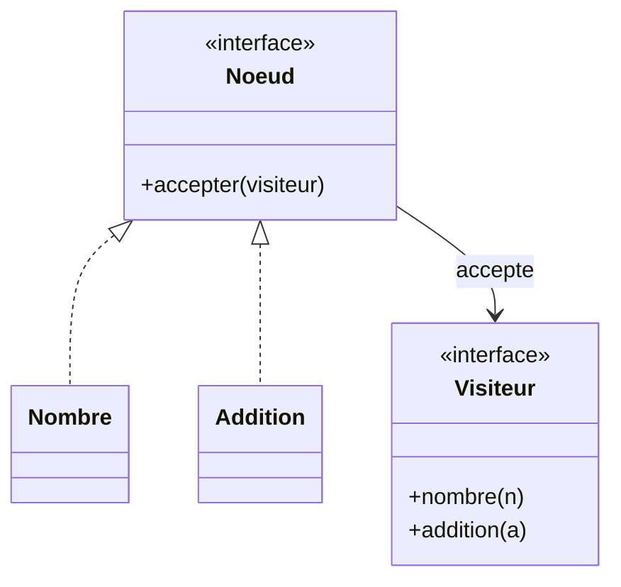

# Visitor — ajouter des opérations à une structure stable

## Problème et intention

Un arbre d'expressions contient des nombres et des additions. On veut successivement l'évaluer, l'afficher ou en compter les nœuds. Ajouter toutes ces opérations aux classes de nœuds les oblige à changer pour chaque nouvel outil. **Visitor** sépare les opérations de la structure : un visiteur regroupe les traitements par type de nœud. Le prix de cette extensibilité des opérations est une plus grande difficulté à ajouter de nouveaux types de nœuds.

## Rôles et double dispatch

Chaque **élément** propose `accepter(visiteur)` et appelle la méthode du visiteur correspondant à son type concret. Un appel initial sur l'interface `Noeud` sélectionne dynamiquement l'implémentation d'`accepter` ; celle-ci appelle ensuite `nombre` ou `addition`. C'est le **double dispatch** recherché : la méthode finale dépend du nœud concret et du visiteur fourni, sans test de type centralisé. Le visiteur peut parcourir les enfants, ou laisser ce parcours à une autre couche ; ici il le fait lui-même.



```ts
interface Noeud { accepter(v: Visiteur): number }
interface Visiteur {
  nombre(n: Nombre): number;
  addition(a: Addition): number;
}
class Nombre implements Noeud {
  constructor(readonly valeur: number) {}
  accepter(v: Visiteur): number { return v.nombre(this); }
}
class Addition implements Noeud {
  constructor(readonly gauche: Noeud, readonly droite: Noeud) {}
  accepter(v: Visiteur): number { return v.addition(this); }
}
class Evaluation implements Visiteur {
  nombre(n: Nombre): number { return n.valeur; }
  addition(a: Addition): number {
    return a.gauche.accepter(this) + a.droite.accepter(this);
  }
}
const valeur = new Addition(new Nombre(2), new Nombre(3))
  .accepter(new Evaluation());
```

Un nouveau visiteur, par exemple pour afficher l'expression, ajoute une opération sans modifier `Nombre` ni `Addition`. En revanche, un nouveau nœud `Multiplication` exige une méthode dans **chaque** visiteur existant : c'est le compromis central. Le retour `number` simplifie l'exemple mais force ici tous les visiteurs à produire le même type ; un contrat générique pourrait lever cette restriction. L'accès aux données des nœuds peut aussi exposer davantage leur structure interne.

## Quand choisir autre chose

Ne pas utiliser Visitor si les types de nœuds changent fréquemment ou si l'opération est unique et locale : le protocole d'acceptation et les méthodes croisées alourdissent alors le modèle. En TypeScript, une **union discriminée** (`{ kind: "nombre"; ... } | { kind: "addition"; ... }`) avec un `switch` exhaustif est souvent plus simple pour un petit arbre : le compilateur signale les variantes non traitées, mais chaque nouvelle opération répète le dispatch. Par rapport à [[Pattern - Strategy|Strategy]], Visitor varie les **opérations sur plusieurs types d'éléments**, tandis que Strategy substitue un algorithme sous un seul contrat côté client.

## Questions

1. Quelles classes faudrait-il modifier pour ajouter `Multiplication` puis un visiteur d'affichage ?
2. Quand préférer une union discriminée avec `switch` exhaustif à cette hiérarchie ?

*Référence conceptuelle : Gamma, Helm, Johnson et Vlissides, **Design Patterns: Elements of Reusable Object-Oriented Software**, Addison-Wesley/Pearson, chapitre des patterns comportementaux. Exemple et formulation originaux.*
