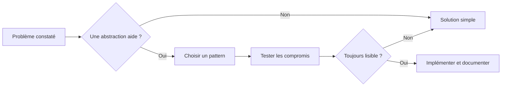

# Design patterns — les 23 classiques

Un **pattern** nomme une solution récurrente à un problème de conception. Ce n'est ni une bibliothèque, ni un objectif en soi : commence par un problème concret et préfère le code le plus simple qui résout ce problème. Les 23 patterns sont ceux du catalogue *Design Patterns: Elements of Reusable Object-Oriented Software* (Gamma, Helm, Johnson, Vlissides). Ils ne remplacent pas les principes de modularité, les tests ou une architecture cohérente.

## Création — comment fabriquer les objets ?

- [[Pattern - Factory Method]] — déléguer le choix d'une création à une sous-classe.
- [[Pattern - Abstract Factory]] — créer des familles d'objets compatibles.
- [[Pattern - Builder]] — assembler un objet complexe étape par étape.
- [[Pattern - Prototype]] — dupliquer une configuration existante avec prudence.
- [[Pattern - Singleton]] — garantir une instance ; à éviter comme état global caché.

## Structure — comment composer des objets ?

- [[Pattern - Adapter]] — raccorder des interfaces incompatibles.
- [[Pattern - Bridge]] — faire varier indépendamment deux dimensions.
- [[Pattern - Composite]] — traiter feuille et groupe de façon uniforme.
- [[Pattern - Decorator]] — ajouter une responsabilité par composition.
- [[Pattern - Facade]] — offrir une entrée simplifiée dans un sous-système.
- [[Pattern - Flyweight]] — partager un état intrinsèque immuable.
- [[Pattern - Proxy]] — contrôler l'accès à un objet via la même interface.

## Comportement — comment répartir les responsabilités ?

- [[Pattern - Chain of Responsibility]] — transmettre une demande entre traitements.
- [[Pattern - Command]] — représenter une action comme objet.
- [[Pattern - Interpreter]] — évaluer une petite grammaire explicite.
- [[Pattern - Iterator]] — parcourir une collection sans exposer son stockage.
- [[Pattern - Mediator]] — coordonner des interactions sans couplage tous-à-tous.
- [[Pattern - Memento]] — conserver un instantané sans exposer l'état interne.
- [[Pattern - Observer]] — notifier des abonnés en mémoire ; pas un bus durable.
- [[Pattern - State]] — changer le comportement selon l'état interne.
- [[Pattern - Strategy]] — substituer un algorithme sans changer son client.
- [[Pattern - Template Method]] — fixer le squelette d'un algorithme via héritage.
- [[Pattern - Visitor]] — ajouter une opération à une hiérarchie stable.

**À comparer :** Factory Method ≠ Abstract Factory ; Adapter ≠ Facade ≠ Proxy ; Decorator ≠ héritage systématique ; Strategy ≠ State ; Observer ≠ livraison durable ; Template Method (héritage) ≠ Strategy (composition). Chaque fiche explique quand **ne pas** utiliser le pattern et donne des questions pour vérifier la compréhension.

**Source du catalogue :** [Pearson, *Design Patterns: Elements of Reusable Object-Oriented Software*](https://www.pearson.com/en-us/subject-catalog/p/design-patterns-elements-of-reusable-object-oriented-software/P200000009480). Les exemples de ce coffre sont originaux et simplifiés ; ils ne proviennent pas du livre.

[[Accueil]] · [[Projets - index]]
